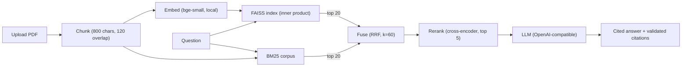

# CiteRAG

*Hybrid-Search Document Q&A with Verified Citations*

CiteRAG is a retrieval-augmented generation (RAG) service for PDF question answering. You upload PDFs, which are split into page-aware chunks, embedded locally with `BAAI/bge-small-en-v1.5` and indexed in FAISS and BM25. A question is answered by combining vector and keyword search with reciprocal rank fusion, reranking the candidates with a cross-encoder, and asking an OpenAI-compatible LLM to answer only from the numbered sources. Every inline marker such as `[2]` in the answer is parsed and checked against the retrieved sources, so each claim comes back with its filename, page, chunk id and snippet, and markers that do not match a source are flagged `invalid`.

## Architecture



## Setup

Requires Python 3.11+.

```bash
python -m venv .venv
# Windows:  .venv\Scripts\activate      Linux/macOS:  source .venv/bin/activate
pip install -r requirements.txt
cp .env.example .env        # Windows: copy .env.example .env
```

Edit `.env` and set `LLM_API_KEY`. Never commit `.env`. All settings can also be provided as plain environment variables.

| Setting | Default | Meaning |
|---|---|---|
| `LLM_BASE_URL` | `https://100milionseek.top/v1` | OpenAI-compatible endpoint |
| `LLM_API_KEY` | (empty) | API key for that endpoint |
| `LLM_MODEL` | `deepseek-v4.1-flash-free` | Chat model name |
| `LLM_TEMPERATURE` | `0.0` | Sampling temperature |
| `LLM_TIMEOUT` | `60.0` | LLM request timeout in seconds |
| `EMBEDDING_MODEL` | `BAAI/bge-small-en-v1.5` | Local sentence-transformers embedding model |
| `RERANK_MODEL` | `cross-encoder/ms-marco-MiniLM-L-6-v2` | Cross-encoder reranker |
| `CHUNK_SIZE` / `CHUNK_OVERLAP` | `800` / `120` | Characters per chunk / overlap |
| `TOP_K` | `5` | Chunks kept after reranking |
| `VECTOR_K` / `BM25_K` | `20` / `20` | Candidates from each retriever |
| `RRF_K` | `60` | Reciprocal rank fusion constant |
| `INDEX_PATH` | `index` | Directory for the FAISS index and metadata |
| `MAX_UPLOAD_MB` | `25` | Per-file upload limit |
| `MAX_REQUEST_MB` | `100` | Total upload limit per request (checked against `Content-Length` and while streaming; the body is already received by then, so this limits staging and ingestion rather than network transfer) |

`.env.example` lists the main ones; the rest can be added the same way.

### Run with uvicorn

```bash
uvicorn app.main:app --host 127.0.0.1 --port 8000
```

The embedding and rerank models load once at startup (the first run downloads them from Hugging Face). Interactive docs are at `http://127.0.0.1:8000/docs`.

### Run with Docker

```bash
docker build -t citerag .
docker run --rm -p 8000:8000 --env-file .env -e INDEX_PATH=/data/index -v citerag-index:/data citerag
```

The image uses CPU-only PyTorch, bakes the two models into the image, runs as a non-root user and stores the index in `/data/index` (the `citerag-index` volume above), so it survives container restarts. The `-e INDEX_PATH=/data/index` flag is needed because `.env` (copied from `.env.example`) sets `INDEX_PATH=index`, which would otherwise override the image default and point at a directory the non-root user cannot write. Use a named volume as shown; a bind-mounted host directory must be writable by UID 1000.

The image is about 3.2 GB. On Windows, run the `docker run` command from PowerShell: Git Bash rewrites `/data/index` and `/data` into Windows paths, which breaks the index location.

### Note on the default LLM endpoint

The default `LLM_BASE_URL` is a third-party service. Retrieved document text and your questions are sent to it, so **use only public documents** with the default endpoint. For private documents, point `LLM_BASE_URL` at a provider you trust (or a local OpenAI-compatible server).

## API examples

The responses below were captured from a locally running server (real models, real LLM) after uploading `data/sample.pdf`. Long `text` fields are shortened with `...`.

The commands use bash syntax (Git Bash, WSL, macOS, Linux). In PowerShell, call `curl.exe` instead of `curl` (which is an alias for `Invoke-WebRequest`) and put each command on one line.

### GET /health

```bash
curl http://127.0.0.1:8000/health
```

```json
{"status":"ok","service":"citerag"}
```

### POST /documents

Multipart upload; the field name is `files` and may be repeated.

```bash
curl -X POST http://127.0.0.1:8000/documents -F "files=@data/sample.pdf"
```

```json
{"results":[{"doc_id":"d10b20ab28a635f8","filename":"sample.pdf","chunks":41,"pages":22,"skipped":false}]}
```

Uploading identical content again returns `"skipped": true` (SHA-256 of the file) and adds nothing.

### GET /documents

```bash
curl http://127.0.0.1:8000/documents
```

```json
{"documents":[{"doc_id":"d10b20ab28a635f8","filename":"sample.pdf","chunks":41,"pages":22,"sha256":"d10b20ab28a635f83d30672382ae79baece82df9e995f8f4c6465d24d915d969"}],"count":1}
```

### DELETE /documents/{doc_id}

```bash
curl -X DELETE http://127.0.0.1:8000/documents/d10b20ab28a635f8
```

```json
{"doc_id":"d10b20ab28a635f8","deleted":true,"chunks_removed":41}
```

### POST /query

`top_k` is optional (1 to 20, default `TOP_K`).

```bash
curl -X POST http://127.0.0.1:8000/query \
  -H "Content-Type: application/json" \
  -d '{"question": "What does error E-4012 mean?", "top_k": 3}'
```

```json
{
  "answer": "Error E-4012 means **suction pressure below minimum**. The pressure transmitter on AI-1 reports less than 0.5 bar for more than 10 seconds. You should check for a closed inlet valve or an air-locked pump. The pump is stopped to prevent dry running [1].",
  "citations": [
    {
      "marker": 1,
      "filename": "sample.pdf",
      "page": 3,
      "chunk_id": "d10b20ab28a635f8:3:0",
      "snippet": "Fault Codes and Diagnostics The front panel display shows a fault code whenever the controller detects an abnormal condition. The most common codes are listed here. Error E-4012: Suction pressure b...",
      "invalid": false
    }
  ],
  "retrieved_chunks": [
    {
      "chunk_id": "d10b20ab28a635f8:3:0",
      "doc_id": "d10b20ab28a635f8",
      "filename": "sample.pdf",
      "page": 3,
      "text": "Fault Codes and Diagnostics\nThe front panel display shows a fault code ... Error E-4012: Suction pressure below minimum. ...",
      "vector_score": 0.6141746044158936,
      "bm25_score": 14.560537246686899,
      "fused_score": 0.03252247488101534,
      "rerank_score": 6.276604175567627
    },
    {
      "chunk_id": "d10b20ab28a635f8:3:1",
      "doc_id": "d10b20ab28a635f8",
      "filename": "sample.pdf",
      "page": 3,
      "text": "Verify the RS-485 wiring, the baud rate, and the slave address, which defaults to 17. Error E-6200: ...",
      "vector_score": 0.6588480472564697,
      "bm25_score": 6.800795547643837,
      "fused_score": 0.03252247488101534,
      "rerank_score": -1.455446720123291
    },
    {
      "chunk_id": "d10b20ab28a635f8:7:0",
      "doc_id": "d10b20ab28a635f8",
      "filename": "sample.pdf",
      "page": 7,
      "text": "Warranty and Support\nThe Orion-7 carries a 36 month limited warranty ... Returned units need an RMA number ...",
      "vector_score": 0.5084288716316223,
      "bm25_score": 2.2084013148606956,
      "fused_score": 0.029850746268656716,
      "rerank_score": -7.523271560668945
    }
  ],
  "latency_ms": 18963.89
}
```

`latency_ms` covers retrieval, reranking and the LLM call. This was the first query after startup on a CPU, so it includes warm-up and the remote LLM round trip. Scores are `null` when a chunk was not in that retriever's top list.

### Error shapes

All errors are JSON with a `detail` message and a machine-readable `code`.

Validation failure (HTTP 422, here an empty question), with per-field `errors`:

```json
{"detail":"Request validation failed","code":"validation_error","errors":[{"type":"string_too_short","loc":["body","question"],"msg":"String should have at least 1 character","input":"","ctx":{"min_length":1}}]}
```

Unknown document (HTTP 404):

```json
{"detail":"Document 'doesnotexist' not found.","code":"http_404"}
```

LLM failures on `/query` use the same envelope: HTTP 429 with `"code": "llm_quota_exceeded"` when the provider reports `daily_quota_exceeded`, and HTTP 502 with `"code": "llm_upstream_error"` for an `upstream_error` (a 502 from the provider is retried once first). Other statuses are 400/413/415 for bad uploads (empty, too large, not a PDF, corrupt or encrypted) and 422 for a PDF with no extractable text. The 429 and 502 shapes were not triggered live; they are covered by the test suite with a mocked LLM.

## Tests

```bash
pip install -r requirements-dev.txt
pytest              # fast suite: no network, no API key, no model downloads
pytest -m slow      # uses the real embedding / cross-encoder models (downloads on first run)
pytest -m live      # calls the real LLM endpoint (needs a real LLM_API_KEY in .env)
```

## Evaluation

```bash
python scripts/eval.py            # add --json results.json to save the raw ranks
```

The script indexes `data/sample.pdf` in a temporary directory with the real embedding and cross-encoder models (no LLM) and runs 17 questions from `data/eval_questions.json`. Each question lists the page(s) that contain the answer. A chunk counts as a match when its (filename, page) is accepted; the rank of the first match decides the score, and only the top 5 results are considered. Modes:

- **vector**: top 5 by FAISS vector score.
- **hybrid+rerank**: vector top 20 + BM25 top 20, fused with RRF (k=60), reranked by the cross-encoder, top 5.
- **bm25**: top 5 by BM25 alone (extra row for context).

The question set has 5 exact-term/ID questions (error and part codes, RMA), 4 paraphrase questions with little keyword overlap, 3 mixed ones and 5 harder, more loosely worded ones (Q13 to Q17). The first 12 were written first; the first 12 questions tied at hit@5 = 1.00 for every mode, so the last 5 harder ones were added, written and page-checked before they were run.

| Mode | hit@1 | hit@5 | MRR |
|---|---|---|---|
| vector | 0.82 | 1.00 | 0.887 |
| bm25 (reference) | 0.82 | 1.00 | 0.892 |
| hybrid+rerank | 0.94 | 1.00 | 0.971 |

All three modes find the right page somewhere in the top 5 for every question (hit@5 = 1.00), so hit@5 does not separate them. Hybrid+rerank puts the right page first more often (hit@1 0.94 vs 0.82, i.e. 16 vs 14 of 17), which shows up as a higher MRR. The sample is small (17 questions on a single synthetic 22-page document), so a difference of one or two questions is not statistically meaningful; treat the numbers as a sanity check rather than a benchmark.

## Design decisions

- **Why hybrid search.** Dense embeddings capture meaning but can blur exact tokens such as error codes (`E-4012`), part numbers (`PN-9902-C`) and RMA numbers. BM25 matches those tokens exactly. The tokenizer keeps compound IDs whole and also indexes their parts. Running both and fusing the rankings with reciprocal rank fusion (`score = sum 1/(60 + rank)`) needs no score calibration between the two very different score scales.
- **Why a cross-encoder reranker.** A bi-encoder embeds the query and each chunk separately, so similarity is only a coarse proxy. The cross-encoder reads the query and chunk together and scores the pair, which is more precise but too slow to run over the whole corpus. It is therefore applied only to the fused candidates (up to 40) to pick the final top 5.
- **How citations are validated.** The prompt numbers the retrieved sources `[1]..[N]`, each with filename and page. After generation, the citation markers are parsed out of the answer and matched against those numbered sources. A marker that maps to a source yields the filename, page, chunk id and a snippet. A marker with no corresponding source (for example `[9]` when only 5 sources were given) is returned with `invalid: true` and no source details, so a hallucinated reference is visible rather than silently trusted.
- **Why an OpenAI-compatible LLM interface.** The LLM is called through `ChatOpenAI` behind a small interface in `app/llm.py`. Switching to OpenAI or any other compatible provider (or a local server) only means changing `LLM_BASE_URL`, `LLM_API_KEY` and `LLM_MODEL` in `.env`, and tests can swap in a fake client without a key.
- **Local models.** Embeddings and reranking run locally, so only the final generation step sends data to a third party.

## Project layout

```
app/
  main.py         FastAPI app, routes, error mapping, lifespan model loading
  config.py       pydantic-settings
  schemas.py      request/response models
  ingest.py       PDF loading, chunking, hashing
  store.py        FAISS + metadata persistence, add/delete
  retrieval.py    vector + BM25 + reciprocal rank fusion
  rerank.py       cross-encoder reranker
  llm.py          OpenAI-compatible LLM client (mockable)
  generate.py     prompt building + answer
  citations.py    citation parsing + validation
tests/            helpers (shared fakes), test_chunking, test_ingest_store, test_retrieval, test_fusion,
                  test_llm, test_generate, test_citations, test_api
data/
  sample.pdf          22-page synthetic manual used for demos and evaluation
  eval_questions.json evaluation questions and expected pages
scripts/
  eval.py             retrieval evaluation
  make_sample_pdf.py  regenerates data/sample.pdf
  demo_phase*.py      small command-line demos (ingestion, retrieval, generation)
Dockerfile, .dockerignore, .env.example, requirements.txt, requirements-dev.txt
```

## Limitations

- BM25 is an in-memory index rebuilt inside a single process; the service is not designed for multiple workers sharing one index directory.
- FAISS uses `IndexFlatIP` (exact, brute-force search), which is fine for thousands of chunks but not tuned for very large corpora.
- Scanned or image-only PDFs are not supported (no OCR; they are rejected with no extractable text), nor are encrypted PDFs.
- `langchain-community` is being sunset and emits a `DeprecationWarning` on import; the FAISS integration lives there.
- The evaluation set is small and based on one synthetic document.
